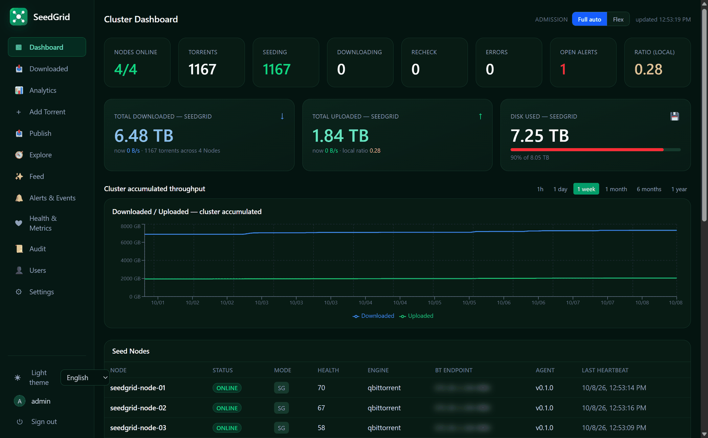
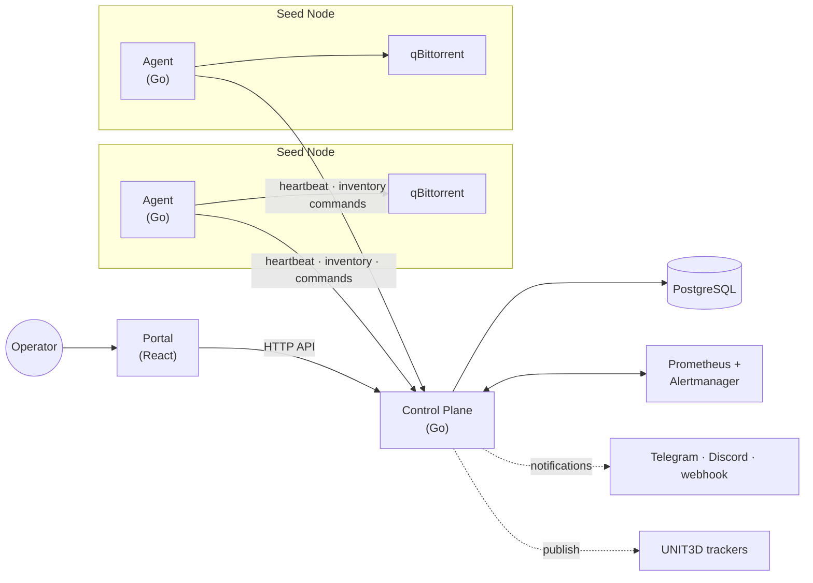
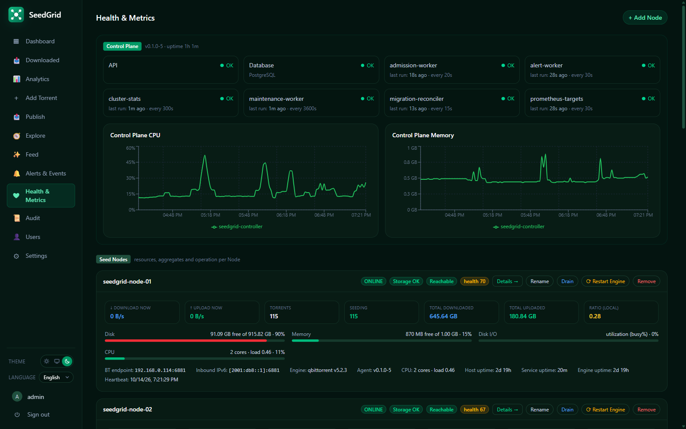
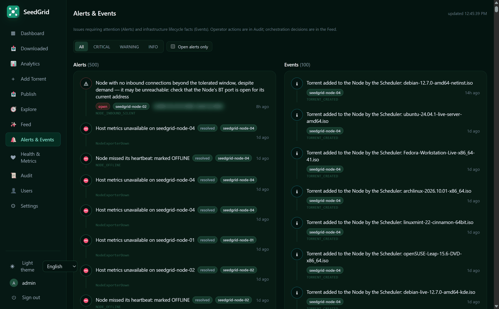
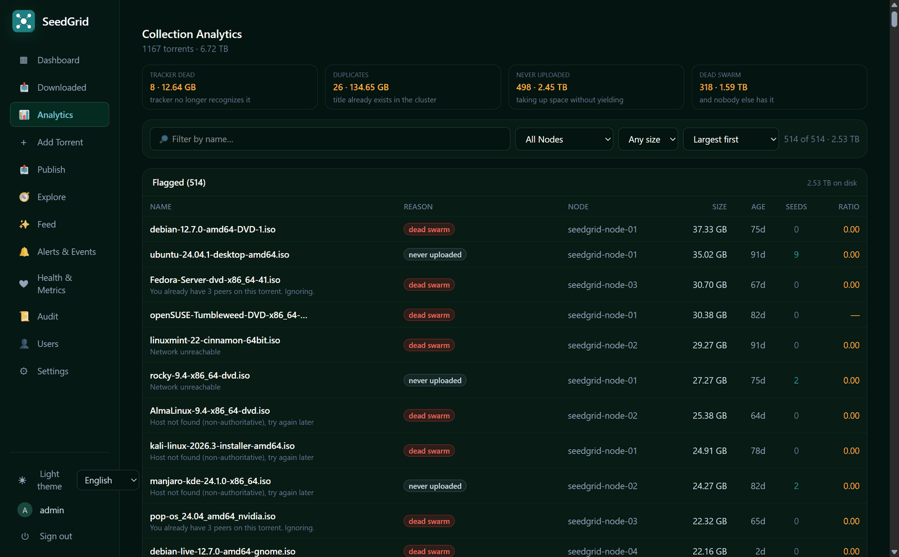
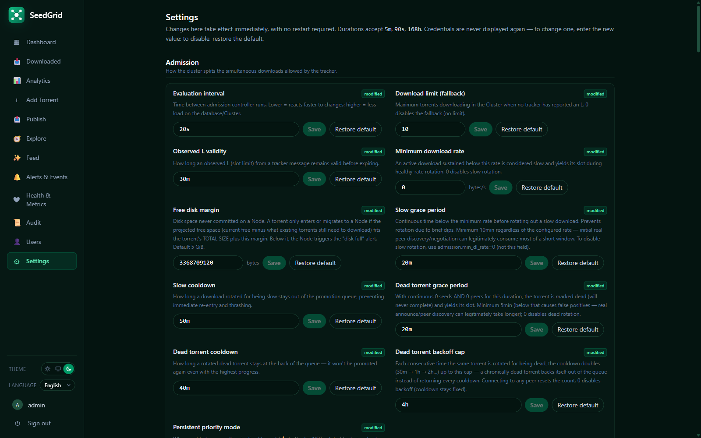

<div align="center">

# SeedGrid

**Run a fleet of BitTorrent seed boxes as one cluster.**

A central Control Plane places torrents on the right machine, keeps every Seed Node healthy and
tells you what needs attention — from a single web Portal.

[](https://github.com/rbferreira/seedgrid/actions/workflows/ci.yml)
[](LICENSE)
[](https://github.com/rbferreira/seedgrid/releases)

English · [Português](docs/pt-BR/Index.md)



</div>

## Why

Seeding from one machine is easy. Seeding thousands of torrents across a few machines — a mini
PC, a NAS, a Raspberry Pi with a USB disk — turns into chores: which box has room, which disk is
failing, which torrent stalled, which one should move. SeedGrid does that bookkeeping for you:

- **One cluster, not N boxes.** Add a torrent once; the Scheduler puts it on a Node that has the
  disk for it. Moving it to another Node later is one click, verified at the destination.
- **It notices before you do.** Node offline, disk filling up, storage unmounted, a Node nobody
  can reach from outside — alerts in the Portal and, if you want, on Telegram, Discord or a
  webhook.
- **Built for private trackers.** It shares your account's download slots across the cluster
  and publishes to UNIT3D sites with the site's own categories, wording and image host.

## How it works



**The Control Plane decides, the Agent executes, the Portal shows.** Agents always call the
Control Plane — never the other way around — so a Node behind NAT or a firewall just works:
it sends its heartbeat and inventory, and picks up its commands (add, pause, migrate, update)
from a durable queue. Only the Control Plane touches the database, and the Portal only talks
to the API.

## What you get

| | |
|---|---|
|  |  |
| **Health & Metrics** — per-Node disk, I/O, network and peers, with one-command onboarding of new Nodes. | **Alerts & Events** — what needs attention now, and what happened, in your language. |
|  |  |
| **Analytics** — throughput, rankings and duplicates across the cluster. | **Settings** — every tunable live, with per-Node overrides. |

- **Zero-touch Nodes:** one command on a new machine and it joins the cluster.
- **Disk-aware scheduling** and **migration** between Nodes, verified at the destination.
- **Admission control** that shares a tracker's download slots and rotates stalled downloads.
- **Agent self-update** from the Portal.
- **Publishing to UNIT3D trackers** with shareable [site profiles](profiles/).
- **English and Brazilian Portuguese** — the Portal, the alerts and the docs.

## Quick start

You need one Linux host with Docker for the Control Plane — a VM, a NAS, a mini PC, a Raspberry
Pi 4/5 — and one per Seed Node.

```bash
# 1. On the Control Plane host, in a directory of its own (Docker Compose 2.23.1 or later)
curl -fsSLO https://github.com/rbferreira/seedgrid/releases/latest/download/compose.yaml
echo 'SEEDGRID_ADMIN_PASSWORD=<choose one>' > .env
docker compose up -d      # the Portal answers on port 80; SEEDGRID_HTTP_PORT in .env changes it

# 2. On each Seed Node — the Portal gives you this line, token included (Health & Metrics → Add Node)
curl -fsSL http://<control-plane>/node/bootstrap-node.sh | sudo CP_URL=http://<control-plane> JOIN_TOKEN=<token> sh
```

The admin password is the only thing you choose; the other secrets are generated on the first
start into the `seedgrid-secrets` volume — back it up together with the database. To update,
download the `compose.yaml` of the new release and run `docker compose pull && docker compose up -d`;
Nodes update from the Portal. Opening the BitTorrent port (a port forward on IPv4, or inbound IPv6)
is up to you — SeedGrid tells you which port each Node uses.

To run a commit that is not a release yet, build on the host instead
(`sh scripts/bootstrap-controller.sh` from a clone). That path, topology, environment variables,
networking and upgrades are all in [Deployment](docs/19%20-%20Deployment.md).

## Documentation

- [Index](docs/Index.md) — start here
- [Architecture](docs/03%20-%20Architecture.md) and [ADRs](docs/ADR.md) — why it is built this way
- [API](docs/13%20-%20API.md)
- [Site profiles](profiles/) — how to add a tracker, even without running SeedGrid

All docs exist in [English](docs/) and [Brazilian Portuguese](docs/pt-BR/).

<details>
<summary>Repository layout</summary>

```
control-plane/   the Control Plane (Go): API, Scheduler, workers, migrations
agent/           the Agent (Go): runs on each Seed Node, drives the Torrent Engine
portal/          the web Portal (React + Tailwind)
shared/          contracts shared by the three (settings, messages, Agent config)
profiles/        site profiles for trackers, one file per site
deploy/          Docker Compose files for the Control Plane, the Nodes and observability
scripts/         bootstrap, build and acceptance scripts
tools/           the project's policy checks, run by CI
docs/            the documentation — the source of truth
```

</details>

## Status

SeedGrid is young (0.x) but runs a real cluster every day. Publishing is tested end to end with
one UNIT3D site; other UNIT3D sites share the same API and should work — if you try one, open an
issue and contribute its profile.

## Contributing

Issues and pull requests are welcome — see [CONTRIBUTING](CONTRIBUTING.md). Security issues go
through [private reporting](SECURITY.md).

## License

[MIT](LICENSE)
